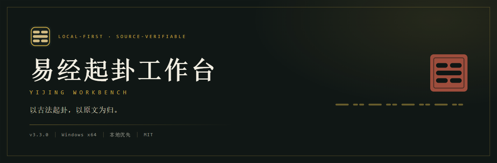
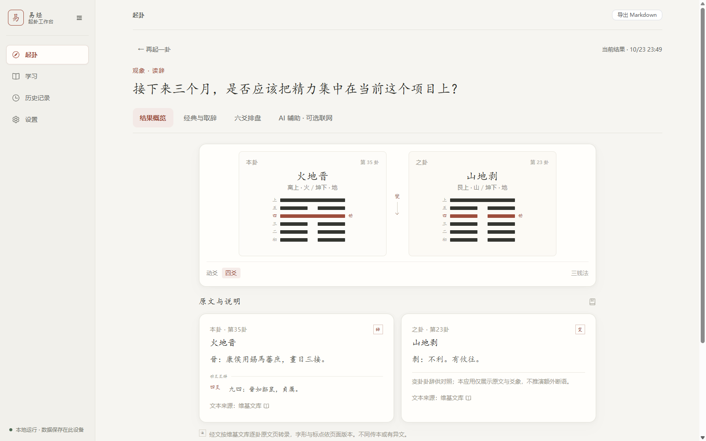
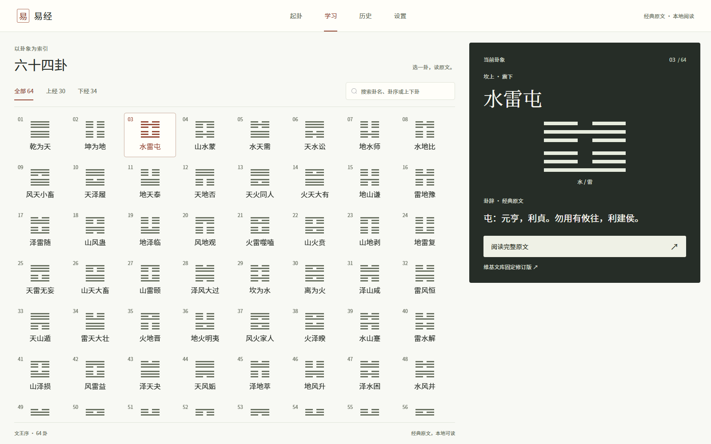
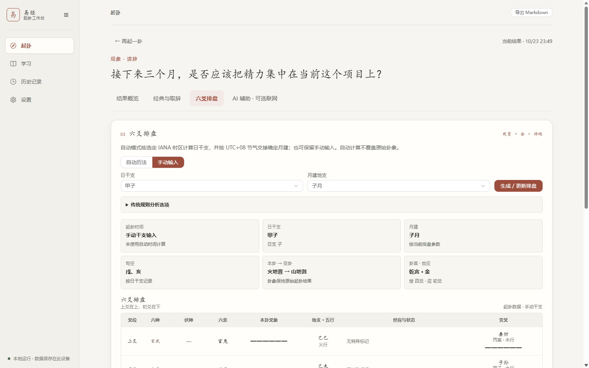
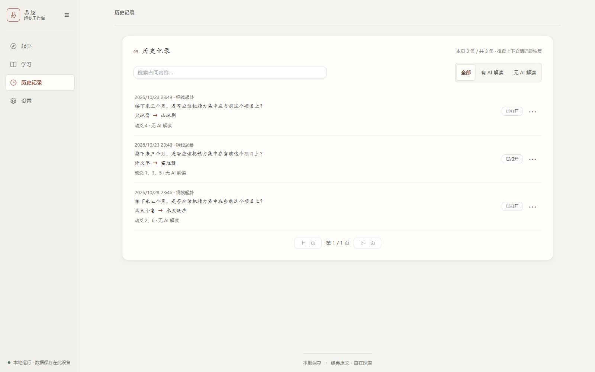

# 易经起卦工作台

<p align="center">
  
</p>

<p align="center">
  
  
  
  
  
</p>

<p align="center">
  <a href="https://qiuizi.github.io/yijing-workbench-public/">官网</a> ·
  <a href="https://github.com/Qiuizi/yijing-workbench-public/releases/download/v3.3.1/yijing-workbench-3.3.1-x64-setup.exe">下载</a> ·
  <a href="https://github.com/Qiuizi/yijing-workbench-public/releases/download/v3.3.1/SHA256SUMS.txt">校验值</a> ·
  <a href="docs/release-v3.3.1.md">文档</a>
</p>

本地优先的周易起卦工具：铜钱或手动起卦、卦辞爻辞原文阅读、六爻纳甲排盘与 64 卦图鉴全部本地完成，历史保存在本机 SQLite；可选 DeepSeek 解读，自备 Key、主动调用、可完全关闭，原文出处可溯。

项目官网：[中文](https://qiuizi.github.io/yijing-workbench-public/) · [English](https://qiuizi.github.io/yijing-workbench-public/en/)。

## 界面截图 (Screenshots)

<table>
  <tr>
    <td align="center"><br>起卦结果：本卦、动爻、之卦与传统取辞（v3.3.0 真实界面截图）</td>
    <td align="center"><br>64 卦图鉴：文王序浏览与检索（v3.3.0 真实界面截图）</td>
  </tr>
  <tr>
    <td align="center"><br>六爻纳甲排盘：干支、六亲、六神、世应与旬空（v3.3.0 真实界面截图）</td>
    <td align="center"><br>历史记录：搜索、AI 筛选与分页（v3.3.0 真实界面截图）</td>
  </tr>
</table>

## 功能 (Features)

- 铜钱起卦：模拟三枚铜钱摇卦，记录每爻阴阳与动爻。
- 手动起卦：手动输入六爻并标注动爻。
- 传统取辞：按启蒙占法依据动爻取卦辞或爻辞，附原文与来源链接。
- 六爻纳甲：干支、旬空、六神、伏神、六亲、世应与变爻排盘。
- 64 卦图鉴与原文阅读：按文王序浏览、检索，逐卦阅读卦辞、爻辞及乾坤特殊爻（用九、用六）。
- 历史记录：占问关键词搜索、有 AI/无 AI 筛选、每页 20 条分页、单条 Markdown 导出。
- 可选 DeepSeek 解读：用户自备 API Key、主动调用，可完全关闭；离线不影响本地功能。

## 安装 (Install)

最新版本 v3.3.1（2026-10-24）。Windows x64 NSIS 安装包，当前用户安装，应用标识 `cn.yijing.workbench`：

- 安装包：[yijing-workbench-3.3.1-x64-setup.exe](https://github.com/Qiuizi/yijing-workbench-public/releases/download/v3.3.1/yijing-workbench-3.3.1-x64-setup.exe)（16,097,113 bytes，约 15.4 MiB）
- 校验文件：[SHA256SUMS.txt](https://github.com/Qiuizi/yijing-workbench-public/releases/download/v3.3.1/SHA256SUMS.txt)

下载后校验 SHA-256：

```powershell
Get-FileHash .\yijing-workbench-3.3.1-x64-setup.exe -Algorithm SHA256
```

期望值：

```text
3CAECBE2CE7684805BA5FBE2D8F60767101CCD71565A4EC37BACB2181B086B74
```

前置条件：

- Windows x64。
- Microsoft Edge WebView2 Evergreen Runtime；缺失时安装程序需联网下载并运行官方 bootstrapper。

首次启动即可使用铜钱起卦、原文阅读、六爻纳甲与本地历史；AI 解读需在设置中填写自备的 DeepSeek API Key。升级前请先关闭应用并备份本机数据。

## 当前版本状态与风险 (Status & Risks)

**v3.3.1 已正式发布。** Windows x64 安装包来自 [main push 构建 Run 39995846568](https://github.com/Qiuizi/yijing-workbench-public/actions/runs/39995846568)，二进制源码 `f6f102f1f87bcc6aebba0ad7eac822ad9b25e882`；Release Tag 是之后仅增补发布文档/工作流的提交，两者区别已写入构建来源记录。

- **导读已获编辑发布批准**：64/64 个 `reviewed`、64/64 条独立批准台账，导读包含 384 条逐爻说明；批准是公开许可，不代表王弼、孔颖达、朱熹古注及影印版本的逐处校勘已全部完成。见 [批准决议](docs/learning-guides-review-05-64.md) 与 [Issue #28](https://github.com/Qiuizi/yijing-workbench-public/issues/28)。
- **自动化 PASS**：Windows 后端 pytest、前端 Vitest、类型检查、签名的 VC143 运行库核验、PyInstaller sidecar 与 Tauri NSIS 构建；打包侧车在**合成数据**环境下的令牌鉴权、64 卦目录和空白历史冒烟测试。安装包的独立 SHA-256 与 CI 原始 Manifest 和 GitHub 发布资产摘要一致。
- **NOT_TESTED（仍有风险）**：v3.3.1 实机安装/覆盖升级/卸载恢复、打包版 GUI/关于页与重启、原生 Markdown 文件落盘、DPAPI 跨 Windows 用户解密、使用真实密钥联网。
- **安装前**：关闭旧版，先备份历史数据库、设置和重要导出。安装包尚未签名，可能触发未知发布者与 Windows SmartScreen；运行需 WebView2 Evergreen Runtime。

详见 [v3.3.1 发布说明](docs/release-v3.3.1.md) 与 [v3.3.1 构建记录](docs/windows-rc-3.3.1-build.md)。旧版 [v3.3.0](https://github.com/Qiuizi/yijing-workbench-public/releases/tag/v3.3.0) 仍可下载，原文件保持不变。

## 技术架构 (Architecture)

| 层 | 技术 | 说明 |
| --- | --- | --- |
| 前端 | Vue 3.5 + TypeScript | 界面逻辑，位于 `frontend/` |
| 桌面壳 | Tauri | Windows 桌面窗口与原生能力，位于 `frontend/src-tauri/` |
| 后端 | FastAPI | 本地 HTTP 服务，以 sidecar 方式运行 |
| 数据库 | SQLite | 历史、AI 会话、设置与备份 |
| 打包 | PyInstaller + NSIS | 后端 sidecar 打包与 Windows 安装程序 |
| 官网 | Vite 6 + Vue 3.5 + TypeScript | 独立静态站点，位于 `website/`，由 GitHub Pages 自动部署 |

`website/` 与 `frontend/` 是两套独立的前端工程，互不影响。

## 仓库结构 (Repository Layout)

```text
.
├── frontend/             # Vue 3.5 + TypeScript 前端与 Tauri 桌面壳
├── backend/              # FastAPI 后端、64 卦数据与测试
├── website/              # 官网（Vite 6 静态站点，GitHub Pages）
├── scripts/              # 构建、打包与内容审核脚本
├── docs/                 # 文档与验收记录
├── .github/workflows/    # windows-rc.yml（桌面构建）、pages.yml（官网部署）、v1-learning-ci.yml（学习导读 CI）
├── LICENSE               # MIT（仅覆盖项目自有代码/测试/构建配置/原创图标）
├── PRIVACY.md            # 隐私与数据处理说明
└── THIRD_PARTY_NOTICES.txt
```

## 开发与测试 (Development & Tests)

Linux（Python 3.12、Node.js 24）：

```bash
python3.12 -m venv .venv
.venv/bin/python -m pip install -r requirements.txt
cd frontend && npm ci && cd ..

.venv/bin/python -m pytest
cd frontend
npm test
npm run typecheck
npm run build
```

Windows（Python 3.12、Node.js 24、Rust MSVC 工具链）：

```powershell
py -3.12 -m venv .venv
.\.venv\Scripts\python.exe -m pip install -r requirements-win.lock.txt
cd frontend
npm ci
cd ..

.\.venv\Scripts\python.exe -X utf8 -m pytest
cd frontend
npm test
npm run typecheck
```

官网：

```bash
cd website
npm ci
npm run dev     # 本地预览
npm run build   # 产出 dist/，由 .github/workflows/pages.yml 部署
```

当前正式 v3.3.1 的 Windows 打包及各项回归以 [Run 39995846568](https://github.com/Qiuizi/yijing-workbench-public/actions/runs/39995846568) 为准；v3.3.0 的历史测试记录仍在原发布说明中。

## 隐私与数据处理 (Privacy)

本地优先：起卦、原文、排盘与历史完全本地处理。应用有两类联网行为——你主动调用 AI 时的 DeepSeek 请求，以及 v3.3.2 起最多每 24 小时一次的 GitHub 更新检查（可在设置中关闭）。AI Key 由当前 Windows 用户 DPAPI 保护，不回显给前端。更新检查只发送版本请求，不上传卦象、历史、设置或密钥；安装前会先做 SQLite 一致性备份。详细范围见 [PRIVACY.md](PRIVACY.md)，更新机制见 [docs/updater/README.md](docs/updater/README.md)。

## 许可与数据来源 (License & Data Sources)

- [LICENSE](LICENSE) 为 MIT 许可，版权 `Copyright (c) 2026 Qiuizi`，只覆盖项目自有代码、测试、构建配置与原创图标，不覆盖古籍文本与第三方组件。
- 应用图标为原创几何图形，来源与生成方法见 [docs/icon-provenance.md](docs/icon-provenance.md)；官网品牌资产与视觉语言见 [website/public/brand/PROVENANCE.md](website/public/brand/PROVENANCE.md)。
- 卦爻辞转录自维基文库《周易》固定修订版，来源与核对记录见 [backend/data/README.md](backend/data/README.md)。
- 第三方组件许可见 [THIRD_PARTY_NOTICES.txt](THIRD_PARTY_NOTICES.txt)。

## 更新记录 (Changelog)

v3.3.2（未发布，分支开发中）：

- 新增应用内更新：启动后自动检查（24 小时节流）、手动检查、下载进度、签名校验、安装后重启。
- 安装前自动创建 SQLite 一致性备份并停止本地 Python 服务，备份失败即取消安装。
- 版本号与发布流水线改为可复用：候选构建与正式发布分离，正式发布需人工审批与正式签名密钥。
- v3.3.1 没有更新器，升级到 v3.3.2 仍需手动安装一次；此后可从 v3.3.2 自动升级。

v3.3.1（2026-10-24）：

- 64 卦现代导读和 384 条逐爻说明已获维护者编辑批准并由新 Windows 安装包提供；完整古籍校勘仍有待办。
- 修正《小畜》《泰》《大过》的注释归属问题，并修改 25 条重复模板式逐爻说明。
- [正式 Release](https://github.com/Qiuizi/yijing-workbench-public/releases/tag/v3.3.1) · [发布说明](docs/release-v3.3.1.md)。

v3.3.0（2026-10-23）：

- 新增 64 卦图鉴与原文阅读。
- v3.3.0 原安装包只有 01–04 卦现代导读可见，05–64 当时仍为草稿。维护者之后批准了全量编辑公开，并已在 v3.3.1 重新打包发行。
- 新增单条 Markdown 导出。
- 历史记录新增搜索、AI 筛选与每页 20 条分页。
- 关于页正确显示版本、MIT 许可范围与 LICENSE 正文。
- 新增官网（GitHub Pages）。

详见 [Release](https://github.com/Qiuizi/yijing-workbench-public/releases/tag/v3.3.0) 与 [docs/release-notes-v3.3.0.md](docs/release-notes-v3.3.0.md)。

v3.2.2：上一稳定版本，见 [v3.2.2 Release](https://github.com/Qiuizi/yijing-workbench-public/releases/tag/v3.2.2)。

## 贡献与反馈 (Contributing)

问题与建议请在 [Issues](https://github.com/Qiuizi/yijing-workbench-public/issues) 提交。64 卦现代导读的审核进度见 [Issue #27](https://github.com/Qiuizi/yijing-workbench-public/issues/27) 与 [Issue #28](https://github.com/Qiuizi/yijing-workbench-public/issues/28)。改动请从 main 创建独立分支，提交 Pull Request 并等待人工审阅后合并。

---

v3.3.1 · 作者 Qiuizi · 版权 © 2026 Qiuizi · [MIT License](LICENSE)
