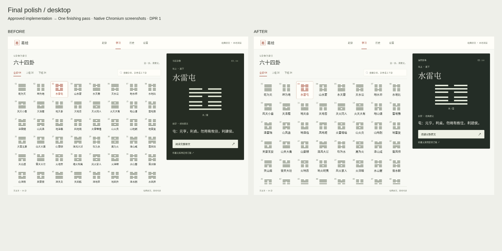
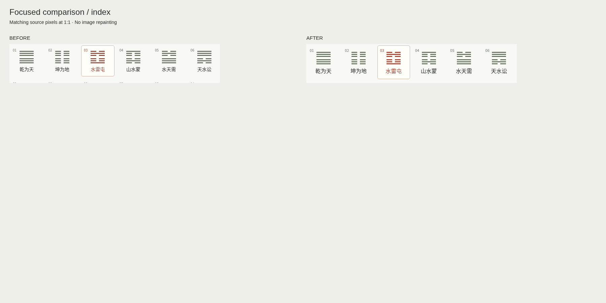
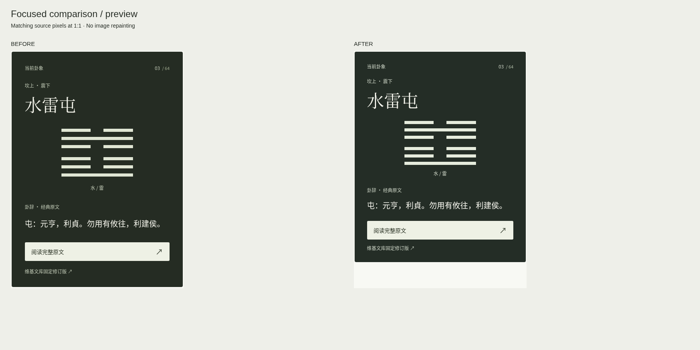

# 易经 UI 2.0：最后一轮视觉收尾自查

final result: passed

范围：仅已初审通过的 B 图鉴主页与 A 阅读详情上的一次定点收尾。此处 passed 指本轮 Linux Chromium 实现自查，用户最终验收仍待反馈；Windows WebView2 为 **NOT_TESTED**。

## 对比基准与状态

- 视觉基准：本轮修改前实际浏览器截图 `docs/review/learning-ui-2/before-desktop.png`、`before-mobile.png`、`before-detail.png`、`before-detail-mobile.png`。它们记录已经初审的 B 主页 + A 详情实现。
- 实现截图：同目录 `learning-desktop.png`、`learning-mobile.png`、`learning-detail.png`、`learning-detail-mobile.png`。
- 桌面源图/实现均 1366×900 像素，CSS 视口 1366×900；手机均 390×844 像素，CSS 视口 390×844；deviceScaleFactor=1，无设备壳、无浏览器边框，未作密度缩放。
- 主页状态：初始全部 64 卦、文王序、当前第 03 卦水雷屯、无搜索；详情为第 01 卦乾为天。相同内容、状态和滚动位置用于比较。
- 只进行一批视觉修改及其后一次实际截图比较；未新增风格，未追加多轮视觉迭代。

## 发现、修复与对比记录

| 级别 | 修改前证据及影响 | 本轮处理 | 修改后证据 |
| --- | --- | --- | --- |
| P2，已处理 | 目录卦名 14px/21px、点击区最小高 92px，桌面扫读偏小。 | 改为 16px/24px、100px；保留 8 列和完整文王序，窄桌面既有 6 列规则保留。 | [索引 1:1 对比](docs/review/learning-ui-2/comparison-focus-index.png)；全部 64 项未挤出按钮。 |
| P2，已处理 | 卦名、卦象、原文和按钮分组偏松，预览存在可压缩的间距。 | 统一收紧预览内边距、图形及文本间距，微调深墨绿和文字对比。 | [预览 1:1 对比](docs/review/learning-ui-2/comparison-focus-preview.png)。 |
| P2，已处理 | 索引最小高度 630px，在较矮桌面可能产生整页滚动；dvh 无后备。 | 移除最小高度、预览 sticky、保留左右独立滚动，补充 vh 和旧 Chromium 滚动条分支。 | [滚动末尾截图](docs/review/learning-ui-2/desktop-scrolled.png)；[11 组桌面窗口测试](docs/review/learning-ui-2/polish-verification.json)。 |
| P3，已处理 | hover 抬升规则没有限定鼠标能力。 | 精细鼠标才启用抬升，键盘焦点补充表面状态，触屏直接点按。 | 触屏模拟进入/返回、无悬停抬升，Home/End 与选中状态一致。 |

全页比较与局部比较均由真实截图在 HTML 中并排排版，再由浏览器截图，无界面重绘。

[手机前后比较](docs/review/learning-ui-2/comparison-mobile.png)；[桌面详情比较](docs/review/learning-ui-2/comparison-detail.png)；[手机详情比较](docs/review/learning-ui-2/comparison-detail-mobile.png)。两张详情的本轮前后 PNG SHA-256 各自完全相同。

## 五项视觉核查

| 核查面 | 结论 |
| --- | --- |
| 字体与排版 | 沿用本地 Noto CJK、原字重体系和自然字距，仅增大目录字号；80 个实际文字节点经 CDP 确认预期字体，无受检 fallback。未观察到字形重叠、异常换行或目录截断。 |
| 间距与布局节奏 | 桌面继续左索引右预览，预览内容聚拢；手机保持轻预览、双列目录和全屏阅读。短视窗不引入整页溢出，预览内滚动可到阅读按钮。 |
| 颜色与视觉变量 | 深墨绿 #242d26、正文 #f7f7ef、辅助字 #cfd7c8，保持现有辨识度；朱砂仅用于当前项和必要导航。无新渐变、纹理或阴影。 |
| 图像及图形质量 | 无新增图片、装饰或替代素材；既有六爻组件与阴阳数据不变，只调整预览爻间距。64 卦编码和上爻至初爻显示顺序均通过回归。 |
| 文案与内容 | 卦名、卦辞、固定修订来源、六爻和乾坤特殊爻全部保留；没有新增未审核解读或说明性装饰文案。 |

## 验证与剩余边界

前端 76 项、后端 186 项通过（DPAPI 1 项跳过），TypeScript/Vite 构建通过。浏览器覆盖 64 卦、7 种常规宽度和额外 11 组桌面尺寸，hover/选中/键盘/触屏模拟、滚动与焦点恢复、异常重试及原业务入口均通过，脚本错误为 0。DPR 与后备规则模拟通过，仅代表当前 Linux Chromium。

当前未发现未处理的 P0/P1/P2。**NOT_TESTED：Windows WebView2/DirectWrite/原生系统缩放与滚动条、Windows DPAPI、实体手机/Safari/Firefox、真实外部 AI 请求、屏幕阅读器。** 没有将这些项目算作通过。

## 实施清单

- [x] 索引文字和点击区增大，文王序与桌面 8 列保留。
- [x] 预览节奏、深墨绿对比、独立滚动及兼容后备完成。
- [x] 手机独立体验及鼠标/键盘/触屏模拟核查完成。
- [x] 四张最终截图、前后比较、自动化和浏览器证据已保存。
- [x] 未实际验证事项明确标记 NOT_TESTED，停止追加视觉迭代。

详细日志和实际修改范围见 [最终交付记录](docs/learning-ui-2-final-polish.md)。
