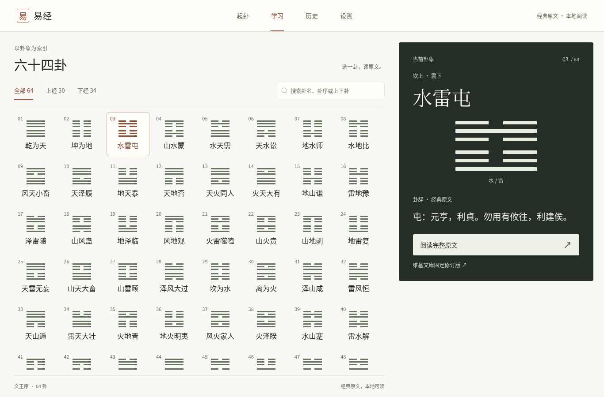

# UI 2.0 分支审阅入口

此分支把六十四卦学习目录接入既有 Vue 3 / Element Plus / Tauri 应用，最终学习主页采用 B 交互图鉴，单卦详情采用 A 编辑式阅读。此前各轮完成的界面拆分、导航、偏好分组和历史菜单调整一并保留。

## 主要行为

- 顶部四项导航、桌面左侧文王序索引与右侧预览；正常桌面为 8 列，完整卦名 16px、点击区最小高 100px。
- 独立手机轻量预览与双列目录，点按直接阅读；鼠标/键盘选中及返回时的搜索、分组、滚动、焦点恢复。
- 原文、固定修订来源、六爻、乾坤用九/用六和上下卦导航保留；未审核导读不作为正式解读展示。
- 本地 Noto CJK 字体及 OFL 许可证，预览 220ms / 阅读 290ms 转场和减少动效支持。
- 增加只读 `/api/hexagrams` 目录端点，复用原详情与原始数据；待完成请求合并与旧响应隔离。

未修改经典原文、卦象映射、数据库结构、AI 协议、Markdown 导出实现、Tauri identifier、版本号或 Release。

## 最终截图

[桌面主页](review/learning-ui-2/learning-desktop.png) · [手机主页](review/learning-ui-2/learning-mobile.png) · [桌面详情](review/learning-ui-2/learning-detail.png) · [手机详情](review/learning-ui-2/learning-detail-mobile.png)

## 已有验证证据

- 前端：17 个测试文件、76 项通过。[日志](review/learning-ui-2/frontend-tests.txt)
- 后端：186 通过、1 跳过（Windows DPAPI）。[日志](review/learning-ui-2/backend-tests.txt)
- TypeScript / Vite 生产构建通过。[日志](review/learning-ui-2/build.txt)
- Chromium 覆盖全部 64 卦正文/爻序、7 种常规宽度、额外 11 组桌面窗口、滚动/键盘/触屏模拟与错误恢复；80 个文字节点的实际字体检查通过。[浏览器日志](review/learning-ui-2/browser-verification.txt) / [补充结果](review/learning-ui-2/polish-verification.json)
- 原有手动起卦、取辞、纳甲、历史、偏好及 Markdown 下载入口走通；AI 仅检查入口，未请求外部模型。[回归日志](review/learning-ui-2/edge-verification.txt)

这些是本分支已完成的 Linux 验证记录，不代表本次执行了 Windows 原生验收。

**NOT_TESTED：Windows Tauri/WebView2 启动、与 Stable 的实机隔离、本地字体的 Windows 渲染、100%/150%/200% 系统缩放、Windows 原生滚动及导出对话框。** 用户已要求停止 Windows 原生验收，本 PR 不补写通过结论。实体手机/Safari/Firefox、真实外部 AI 请求和完整屏幕阅读器认证也未验证。

后续审阅以 [最终收尾记录](learning-ui-2-final-polish.md) 和 [设计自查](../design-qa.md) 为准。其余早期文档保留为开发历史，其中 `/workspace/scratch` 链接指向当时的本地过程产物；本页和最终收尾记录使用的主要截图、测试结果已收进仓库。

本 PR 等待人工审阅，不自动合并，不发布安装包或 Release。
